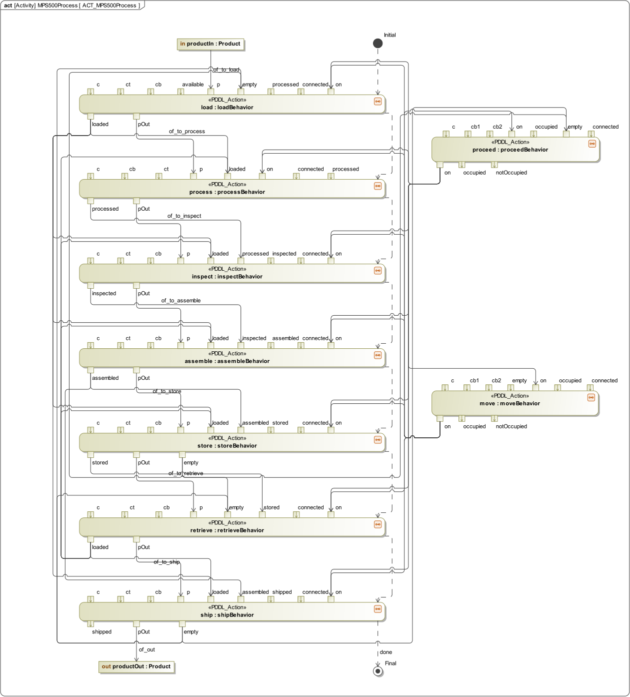

# MPS500 application example

A SysML model of the Festo MPS500, a training plant with a transfer belt and several
processing stations, in 19 configurations and three more for rule coverage. Each configuration is
turned into a PDDL description and checked.

Requires the repositories [`pddl-sysml-profile`](https://github.com/HamiedNabizada/pddl-sysml-profile) and [`sysml-pddl-transformation`](https://github.com/HamiedNabizada/sysml-pddl-transformation). Built and tested with Magic Systems of Systems Architect (MSoSA) 2024x; the transformation runs in its Report Wizard (Apache Velocity 2.3).

## Contents

    CONFIGURATIONS.md  What differs between the variants
    PLANNERS.md        Where each planner package comes from and which version ran
    models/            The annotated models as MSoSA projects (22)
    pddl/              The generated domains and problems (22 pairs)
    plans/             Plans of two reference planners (38), planner_portfolio.csv
    plans/portfolio/   Every plan of the planner portfolio, one folder per configuration
    images/            The activity diagram of B

## The configurations

Each configuration is named after the level at which it varies: `B` is the
baseline, `I1`–`I12` change only the instance level (objects, initial state, goal, belt
topology), `T1`–`T3` the types and `P1`–`P3` the process description. `V1`–`V3` are not plant
variants; they cover features of the profile that a plant model does not use.

| Name | Meaning |
|---|---|
| `B` | baseline: one carrier, one thermometer, goal "shipped" |
| `I1`–`I7` | instance variants of the same plant: other workpieces, more carriers, another goal, a second shipping station |
| `I8`–`I11` | four transport topologies |
| `I12` | a shortcut in the belt ring of the baseline |
| `T1` | reduced, fewer stations |
| `T2` | extended, an additional finishing stage |
| `T3` | hierarchy, two product subtypes and a goal over their supertype |
| `P1` | a rework loop |
| `P2` | assembly, a joining operation with part consumption |
| `P3` | generic, one capability-based action instead of three specific ones |
| `V1`, `V2`, `V3` | rule coverage, see CONFIGURATIONS.md |

One configuration is misconfigured on purpose: `I4` is missing the belt connection to the
assembly station, and its planning problem has no solution.

## Pins and object flows

Preconditions and effects of the actions come from their pins: an input pin typed with a
`«PDDL_Predicate»` signal is a precondition, an output pin an effect. This holds for every
action of the plant configurations; only the capability-based action of `P3` keeps a
formula. The two moves, `move` and `proceed`, carry the predicate `on` on an input and an output
pin. The tag `arguments` on each pin names the parameters of the atom, `?c ?cb1` going in and
`?c ?cb2` coming out, so the transformation deletes the old position because the two atoms
differ.

Where an output pin of an action and an input pin of another action in the same activity carry the
same predicate and neither is negated, an object flow connects them, 698 flows across the 22
configurations. The flows carry no annotation. The transformation reads the pins, so the generated
files are the same with or without the flows.
In `MPS500_B.mdzip` the flows are also drawn in the activity diagram `ACT_MPS500Process`.

## Reproducing the chain

Every configuration comes with the annotated model and the planning description generated from
it. To follow the chain, open the model in MSoSA, generate the description again and compare
it with the file in `pddl/`.

What comes out is equivalent but not character-identical. MSoSA does not iterate model
elements in a stable order, so types, predicates and actions may be sorted differently, as may
the type names within one line of the type declaration. For PDDL this makes no difference in
meaning. A comparison should therefore treat the file as a set of lines, and each line of the
type declaration as a set of names.

The models include the profile as a *used project*. The stored path points at the machine where
they were created, so the first time you open one, MSoSA reports that it cannot find the
project and asks. Point it at `profile/PDDL-SysML_Profile.mdzip` from the [`pddl-sysml-profile`](https://github.com/HamiedNabizada/pddl-sysml-profile)
repository. After saving once, MSoSA remembers the new location.

## The plans

The folder holds the plans of two reference planners, `lama-first` (satisficing) and Scorpion
(optimal), with the planner name as part of the file name. `portfolio/` contains every plan of
the planner portfolio below, 1888 files named `<config>/<package>.plan`. All plans were checked
with VAL against the files in `pddl/`.

For 14 of the 18 plant configurations that have a plan, `lama-first` already finds the optimal
length. Only `I3` and three of the topology variants (`I8`, `I10`, `I11`) get shorter under optimizing search.

### Planner portfolio

`planner_portfolio.csv` covers 54 planners in 108 packages on all 22 configurations, 2376 runs in
total, with a time limit of 1800 s. A planner counts once however many
packages it has: `lama` and `lama-first` are LAMA, and the agile, satisficing and optimal packages
of a competition entry are one planner. The column `planner` names the planner, `package` the
package that ran. Besides the IPC 2023 planners from planutils and LAMA, FF,
ENHSP, POPF, OPTIC, LPG-TD, Metric-FF and SMTPlan, the portfolio includes all ten teams of the
numeric track of IPC 2026 and NLM-CutPlan and OMTPlan from the numeric track of IPC 2023.
[PLANNERS.md](PLANNERS.md) gives the source and version of every package.

Each run records the class (`optimal` or `satisficing`), numeric support, status, plan length,
cost and VAL verdict. Length and cost of a reported plan come from VAL. The status says what the
planner reported:

- `solved`, `unsolvable`, `timeout`, `out-of-memory`
- `rejected` for input it will not process
- `error` for a crash
- `no-plan` for a run that ends without a plan and without a verdict
- `not-run` for 21 runs of two Hapori Delfi packages that could not be started

Whether a reported plan holds is the column `val`.

- 43 planners solve all 18 solvable plant configurations and `V1`. `V2`, which uses the numeric
  effects `scale-up`, `scale-down` and `assign`, is solved by nine planners with numeric support.
  ENHSP runs out of memory on it. Fast Downward and the classical planners built on it reject
  general numeric fluents.
- Of the 1888 plans reported, 1884 are valid according to VAL. The other four come from the two
  PlanForge packages on `I4` and `V3`.
- 28 optimizing planners agree on every plan cost.
- `I4` is reported as unsolvable by 47 planners. The Fast Downward family, every planner whose log
  shows the Fast Downward translator (dual-BFWS included), finds no relaxed solution while
  grounding. A few portfolios among them run further components before they stop. The verdict
  rests on seven separate implementations: the Fast Downward family, FF (simplifies the goal to
  false; Metric-FF runs on its code), ENHSP (detects the initial state as a dead end; Panino runs
  on its code), Powerlifted, Tempest, Tyr and nplanning. POPF is among the 47, but it gives the
  same message for the solvable `P1`, so its verdict does not count towards the seven
  implementations. LPG-TD is also among the 47. It reaches its verdict in preprocessing that,
  according to its output, comes from FF. It does not count separately either.
- PlanForge reports a solution for `I4`, an empty plan after `Empty goal!`, and VAL rejects it.
  It also returns a plan for `V3`, whose domain VAL rejects. Six planners give no verdict on
  `I4`: OMTPlan, OPTIC, PATTY, PATTYINT, SMTPlan and TamerLite.

One planner, OPTIC, rejects every domain. It needs a formulation without ADL, while every
generated domain uses negative preconditions and two of them also conditional effects. The planutils release of
Powerlifted stopped at the same point for a narrower reason, `Actions with negated preconditions
not supported yet`. Its 2023 release solves the plant variants.

POPF accepts the plant domains but considers `P1` unsolvable although 51
other planners solve it. Its message says that no action adds the goal fact
`(shipped thermo1)`, while the action `ship` does. POPF solves none of the configurations
within the time limit. It is the only planner that reports a solvable configuration as
unsolvable.

### Configurations without a plan

Besides `I4`, one more configuration ends up without a valid plan. `V3` is annotated with errors,
and its generated file carries markers where the broken formulas were. 50 planners reject it,
three crash on it, and PlanForge returns a plan that VAL rejects together with the domain.

## Limits

The models cover topology and capabilities, not the control system. A generated plan is
therefore not a statement about what the real plant would execute.

## License

Copyright (c) 2026 Hamied Nabizada. The models, the generated planning descriptions, the plans, the tables and this
documentation are licensed under the Creative Commons Attribution 4.0 International License (CC BY 4.0), see
[LICENSE](LICENSE).
